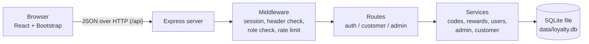
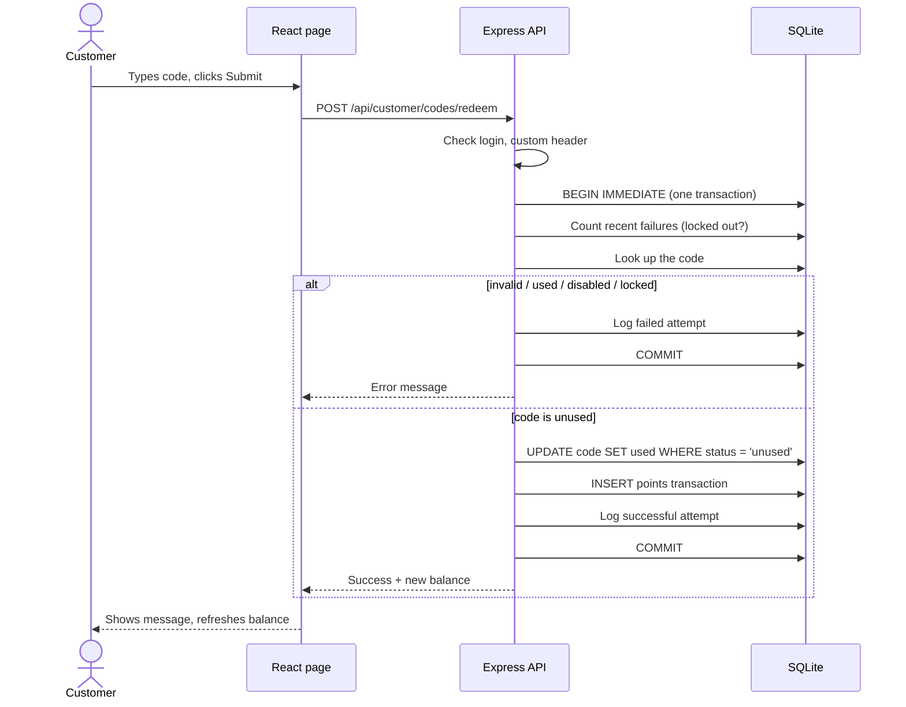
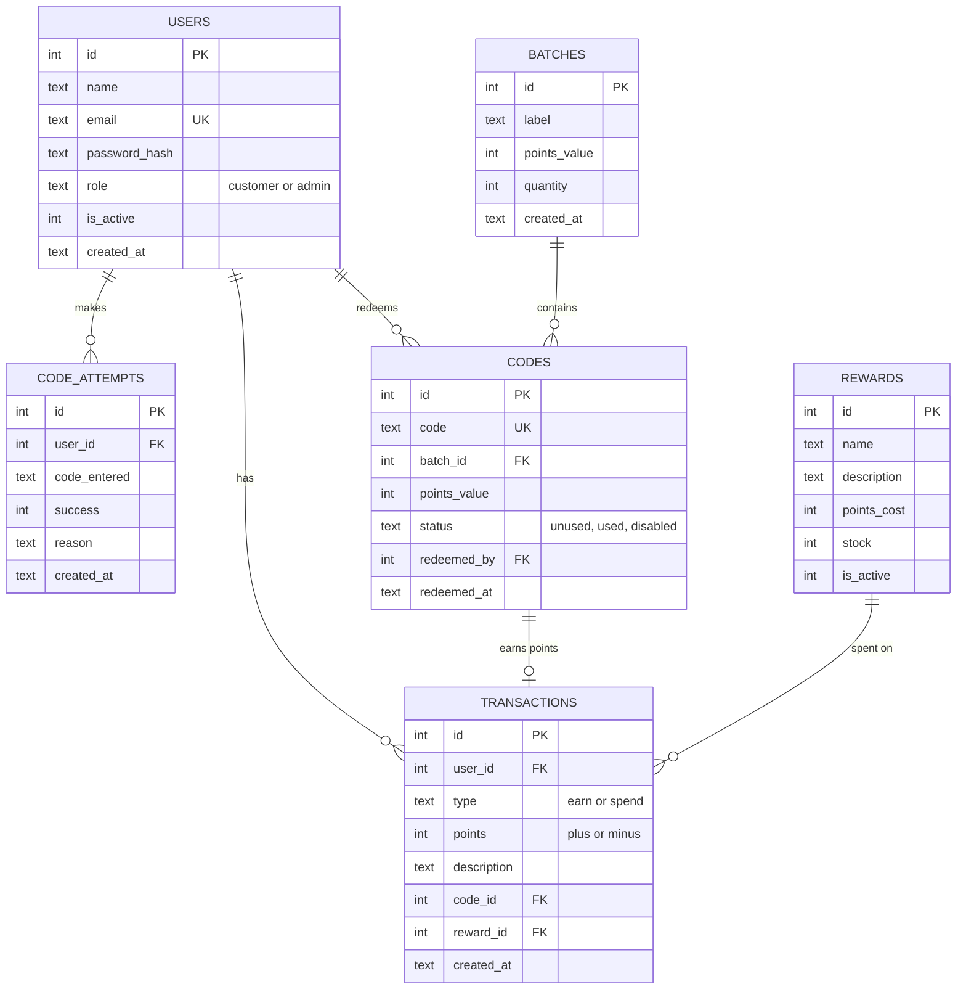

# Architecture

## 1. Technology stack and reasons

| Part | Choice | Reason |
|---|---|---|
| Frontend | React + Vite + Bootstrap 5 | React keeps screens in small components. Bootstrap gives a clean, responsive layout with little CSS. Vite builds the site into plain files. |
| Backend | Node.js + Express 4 | JavaScript on both sides, so one language to learn. Express is the most common simple server tool. |
| Database | SQLite via built-in `node:sqlite` | One file, no server to install, free. It supports UNIQUE rules, CHECK rules and transactions, which are the tools used to stop code reuse. |
| Sessions | `express-session` with an HTTP-only cookie | Standard, simple login handling. The cookie cannot be read by JavaScript in the browser. |
| Passwords | `scrypt` (built into Node) | A slow, salted hashing method designed for passwords. No extra package. |
| Tests | Node's built-in test runner | Nothing to install. |

In production the Express server also serves the built React files, so the whole app runs as **one process on one port**.

## 2. Application architecture

The code is split into three layers so each part is easy to explain:

- **Routes** (`src/routes`) only read the request and send the response.
- **Services** (`src/services`) contain the real rules: generating codes, redeeming them, spending points. They are what the automated tests exercise.
- **Database** (`src/db.js`) defines the tables and the safety rules.

### Redeeming a code (the core flow)

## 3. Data model

| Table | Purpose |
|---|---|
| `users` | Customers and the single admin. `role` separates them. |
| `batches` | One row per generated group of codes (label, points, quantity). |
| `codes` | One row per printed box code and whether it has been used. |
| `code_attempts` | Log of every code submission, good or bad. Used for lockout and monitoring. |
| `rewards` | The reward catalogue with cost and stock. |
| `transactions` | The points ledger. A customer's balance is the sum of their rows. |

## 4. Fraud prevention (defence in layers)

| Layer | Protection |
|---|---|
| Code design | Codes are random, 12 characters, about 7.9 x 10^17 possibilities. They cannot be guessed or predicted. |
| Database rule 1 | `UNIQUE` on `codes.code`: two boxes can never share a code. |
| Database rule 2 | `UPDATE ... WHERE status = 'unused'` can succeed only once per code. If it changes 0 rows, the redemption is refused. |
| Database rule 3 | A `CHECK` says a code is "used" only if it has an owner. A unique index allows at most one points transaction per code. |
| Transactions | Checking and marking a code, and awarding points, happen in a single `BEGIN IMMEDIATE` transaction, so two people cannot claim the same code at the same moment. |
| Lockout | 5 failed attempts in 15 minutes block that customer from submitting codes. |
| Audit trail | Every attempt is stored and visible to the owner. |
| Admin control | The owner can disable unused codes and disable customers. Used codes cannot be altered. |

## 5. Security measures

- Passwords are salted and hashed with scrypt. Login gives the same message for an unknown email and a wrong password, and takes similar time for both.
- Customer and admin logins are separate. A customer account can never open admin pages, and the server re-checks the role on every request.
- The user is reloaded from the database on every request, so disabling a customer takes effect immediately.
- A new session id is created at login, and the cookie is HTTP-only and `SameSite=Lax`.
- All changing requests must carry an `X-Requested-With` header, which other websites cannot add (basic protection against cross-site request forgery).
- All database queries use prepared statements, which prevents SQL injection. React escapes output, which prevents script injection.
- Login routes are rate limited.
- Secrets live in `.env`, which is excluded from Git. `.env.example` has placeholders only.

## 6. Known limitations

- One server and one database file: right for one factory, not for very large scale.
- Sessions are kept in memory and reset when the server restarts.
- No email verification or password reset (see `ASSUMPTIONS.md`).
- The login rate limit is in memory and per IP address.
